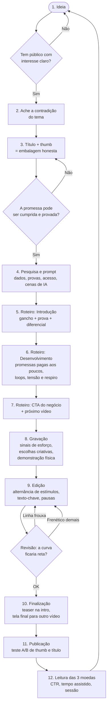

# Processo de criação: do prompt à publicação

Fluxograma baseado no sistema ensinado no vídeo (introdução → desenvolvimento → CTA), com as 3 moedas como critério em cada etapa. Abaixo do diagrama está o que fazer em cada etapa.

## O que fazer em cada etapa

| Etapa | O que fazer | Pergunta de controle |
|---|---|---|
| 1. Ideia | Escolha um tema que um público específico **já procura** (rede de interesse). Olhe canais pequenos com muitas views no nicho. | Quem assistiria até o fim? |
| 2. Contradição | Ache o dado ou a afirmação que **quebra a crença** do público (ex.: "o top 1% daqui é pobre lá"). | O que vai fazer a pessoa dizer "como assim?" |
| 3. Título e thumb | Crie a **embalagem** que gera a expectativa certa. Faça 2 ou 3 variações para o teste A/B. Nada de clickbait. | O vídeo entrega exatamente o que a embalagem promete? |
| 4. Pesquisa e prompt | Junte provas (números, documentos, viagens, entrevistas) e defina o diferencial. Para cenas com IA: character sheet → cenário → objeto → prompt de vídeo. | Qual é a prova mais forte que eu consigo mostrar nos primeiros segundos? |
| 5. Introdução | **Gancho** (contradição) + **prova** (repetir a pergunta do título, mostrar o que vai acontecer ou um teaser do melhor momento) + **diferencial** (esforço, autoridade, acesso, personalidade). | Em 30 s ficou claro o que vem e por que me assistir? |
| 6. Desenvolvimento | Divida em blocos. Cada bloco paga uma promessa e abre outra. Use listas numeradas, quizzes, objeções na voz do público e demonstração física. | Em todo minuto existe um motivo novo para continuar? |
| 7. CTA | Ligue o conteúdo ao seu **negócio** (produto, serviço, evento) e termine levando a **outro vídeo seu**. Não peça like. | O CTA parece a continuação natural do que foi ensinado? |
| 8. Gravação | Mostre esforço (2ª câmera, cenário, objeto real). Faça escolhas criativas que revelem personalidade. Use o roteiro como referência e improvise. | Isso parece feito com cuidado e por uma pessoa de verdade? |
| 9. Edição | Troque o estímulo a cada bloco (tela, b-roll, animação, entrevista). Use texto grande só em palavras-chave e mantenha as pausas antes das revelações. | Eu estou deixando a linha frouxa ou puxando forte demais? |
| 10. Finalização | Ponha um **teaser de 1 a 2 s** do melhor momento na intro. Use tela final e cards para o próximo vídeo. | A intro prova que a promessa vai ser cumprida? |
| 11. Publicação | Suba com o **teste A/B** de thumb e título (ele decide pela watch time). | Qual embalagem trouxe quem assiste mais? |
| 12. Leitura | Olhe CTR, retenção (alvo de 70–80% aos 30 s, curva reta) e sessão. Leve o aprendizado para a próxima ideia. | Onde a curva caiu e o que estava na tela nesse momento? |
